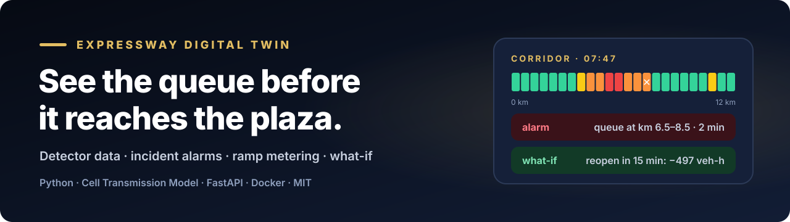
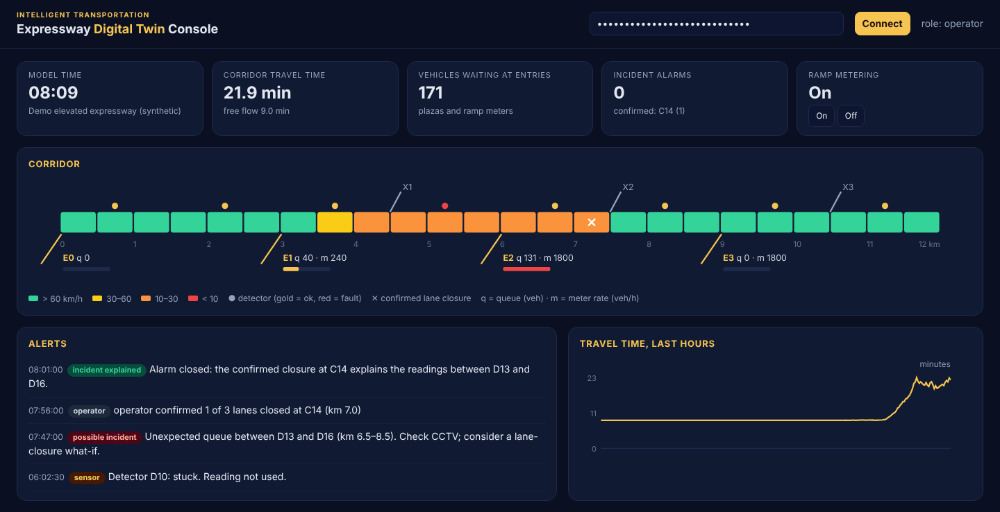
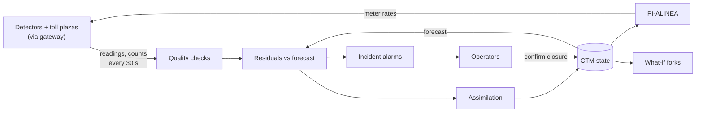

<p align="center"></p>

# Intelligent Transportation Digital Twin

[](https://github.com/md-rubbaite/intelligent-transportation-digital-twin/actions/workflows/ci.yml)


A digital twin for an expressway corridor with toll plazas. A traffic model runs alongside the
road and is **corrected every 30 seconds from detector data**. Operators get the live state,
**incident alarms**, **ramp-meter rates** and **what-if answers** ("what if the lane reopens in 15
minutes instead of 30?") computed from the corridor as it is right now.

> **All data in this repository is synthetic.** The demo corridor, demand and plaza service rates
> are illustrative assumptions, not a model of any real road. See [limits](#limits).

## What it does

| Capability | How |
|---|---|
| **Traffic model** | Cell Transmission Model (Daganzo): 24 cells of 500 m, capacity drop, FIFO exits, priority merges, toll-plaza queues split ETC / manual, ramp-meter limits. Vehicle conservation is tested |
| **Data quality** | Every reading is checked: missing, out of range, stale, future, inconsistent (flow ÷ speed vs occupancy), stuck. Rejected readings are listed with their reason and not used |
| **Staying in step** | Nudging filter: the model is pulled toward good readings, with corrections interpolated between detectors; the demand level is corrected from plaza transaction counts |
| **Incident alarms** | Readings are compared with the model's forecast, not with each other, so the known lane-drop bottleneck does not trigger alarms. An alarm needs 3 suspicious intervals out of 4; it clears by itself; operators are asked to reopen closures the road no longer shows |
| **Ramp metering** | PI-ALINEA for nearby and remote bottlenecks, with a queue override so ramp queues do not spill onto city streets |
| **What-if** | Fork the live state and compare scenarios with a baseline: lane closures, reopening time, demand change, metering on or off, plaza lanes. Warnings when a queue would exceed its storage |
| **Plaza sizing** | Erlang C (M/M/c): the fewest toll lanes that keep the mean wait under a target |
| **Operations** | Operator console, OpenAPI, viewer / planner / operator keys, Prometheus metrics, JSON access logs, non-root read-only container |

<p align="center"></p>
<p align="center"><sub>Operator console during the demo incident (synthetic data). <a href="assets/console-full.png">Full console</a> with entry queues, detector health and a what-if result.</sub></p>

## Demo: incident on the expressway

`itwin demo` runs two copies of the model. One plays the twin. The other plays the road, with 5 % more demand, random variation, detector noise, a frozen detector and a lane closure the twin is not told about. Only readings and plaza counts pass from the road to the twin. Output, shortened:

```text
2. Run twin and road together 06:00 -> 07:45 (twin sets ramp meters on the road)
   speed error twin vs road: 0.3 km/h (mean over cells)
   sensor alerts: Detector D10: stuck. Reading not used.

3. Hidden incident on the road at 07:45, km 7.0 (1 of 3 lanes closed). The twin is not told.
   07:47:00 ALARM: Unexpected queue between D13 and D16 (km 6.5–8.5). Check CCTV; consider a lane-closure what-if.
   detected 2 min 0 s after it started

4. Operator checks CCTV and confirms 1 lane closed at km 7.0; the twin applies it
   08:00:00: corridor travel time 20.2 min (free flow 9.0); speed error vs road 5.6 km/h

5. What-if from now, 60 min ahead. Baseline: the lane stays closed for the whole hour
   scenario                                             Δ delay (veh-h)  Δ mean travel time
   Lane reopened in 15 min                                         -497           -15.1 min
   Lane reopened in 30 min                                         -234            -7.3 min
   Lane reopened in 30 min, metering off                           -224            -4.7 min
   Lane stays closed, 2 more manual lanes at Entry A                 +0            +0.0 min
      no measurable effect: this is not where the corridor is constrained
   Lane stays closed, demand 10% higher                            +305            +2.2 min

6. The road clears at 08:15. The twin keeps the closure until the operator reopens it
   08:19:00 PROMPT: More traffic is passing C14 than 1 closed lane(s) allow (detector D16). ...

7. Conservation check on the road model: arrived − exited − on network = 0.000000 veh
```

The what-if table puts a number on clearance time: reopening at 15 minutes instead of 30 saves about 260 vehicle-hours in the next hour. It also shows that extra plaza lanes at Entry A would change nothing today.

## Quick start

```bash
pip install -e ".[dev]"
itwin demo                       # scripted scenario above
python examples/validation.py    # numbers in the validation table
itwin sizing --arrivals 1850 --service 350 --target-wait 60

export ITWIN_API_KEYS="viewer:$(openssl rand -hex 16),planner:$(openssl rand -hex 16),operator:$(openssl rand -hex 16)"
echo "$ITWIN_API_KEYS"           # keys for the console
itwin serve                      # http://127.0.0.1:8080/dashboard  ·  OpenAPI at /docs
```

Or in a container: `cp .env.example .env`, replace the keys, `docker compose up -d --build`.

## API

| Method | Path | Role | Purpose |
|---|---|---|---|
| GET | `/v1/state` | viewer | Cells (speed, density, LOS), entries (queues, meters, waits), sensors, alerts |
| GET | `/v1/network`, `/v1/history`, `/v1/alerts` | viewer | Corridor description, travel-time history, alert log |
| POST | `/v1/what-if` | planner | Compare a scenario with the baseline from the live state |
| POST | `/v1/plaza/sizing` | planner | Toll lanes needed for a target wait |
| POST | `/v1/readings` | operator | Detector readings and plaza counts (feed mode) |
| POST | `/v1/closures` | operator | Confirm or reopen a lane closure |
| POST | `/v1/metering` | operator | Switch ramp metering on or off |
| GET | `/metrics`, `/healthz`, `/readyz`, `/dashboard` | none | Prometheus metrics, probes, console (the console asks for a key) |

```bash
curl -s -X POST localhost:8080/v1/what-if -H "x-api-key: $PLANNER_KEY" -H 'content-type: application/json' \
  -d '{"name": "Close 1 lane at km 7 for 30 min", "horizon_min": 60, "closures": [{"cell": "C14", "lanes_closed": 1, "duration_min": 30}]}'
```

## Architecture



More detail: [architecture notes](docs/architecture/overview.md) · ADRs: [0001 CTM, not microsimulation](docs/adr/0001-macroscopic-ctm.md) · [0002 nudging, not EnKF](docs/adr/0002-nudging-assimilation.md) · [0003 residual-based incident detection](docs/adr/0003-residual-incident-detection.md) · [0004 the twin advises, people confirm](docs/adr/0004-human-confirmed-closures.md) · [threat model](docs/security/threat-model.md) · [deployment](docs/deployment.md)

## Validation (synthetic)

From `examples/validation.py`. Detector thresholds were tuned on different random seeds from the ones used here.

| Check | Result |
|---|---|
| False alarms, incident-free peaks (8 runs) | none |
| Single-lane closures that create a queue (4 locations) | detected in 1.5–3.0 min, correct section |
| Closures where demand ≈ remaining capacity, or just upstream of an on-ramp (3 locations) | late or not detected: no queue forms, or ramp traffic fills the gap |
| Tracking error during the peak | median 0.0, 95th percentile 4.7 km/h |
| Ramp metering over the peak | mainline vehicle-hours −4 %, worst travel time 14.8 → 13.0 min; total vehicle-hours unchanged (the delay moves to the ramps) |

The road and the twin share one model structure here, so these results test the estimation, detection and control logic. They do not test how well a CTM represents a particular expressway; that needs field data.

## Limits

- One direction, one corridor, one vehicle class. No weaving or lane choice at plazas.
- Not calibrated to any real road. Section 8 of the [architecture notes](docs/architecture/overview.md#8-limits-and-the-path-to-a-real-corridor) lists what calibration and field validation need.
- Flow-based incident detection misses closures that do not cause queues; use it with CCTV analytics and probe data.
- Advisory system: alarms prompt people; closures enter the model only when an operator confirms them; the only automatic output is a bounded meter rate.

## Project layout

```text
src/itwin/        network · ctm · sensors · estimation · control · plaza · scenario · twin · api · cli · demo
tests/            129 unit and integration tests (conservation, physics, quality checks, detection, API roles)
examples/         validation.py (numbers above) · feed_client.py (gateway sketch)
docs/             architecture notes, ADRs, threat model, deployment guide
```

## Author

Rubbaite T. Hassain, System/Solutions Architect on an urban elevated expressway programme (since 2026). This repository is independent work on synthetic data and contains no project data or code.

Architecture, requirements and review by Rubbaite T. Hassain; implementation AI-assisted.

## License

MIT
