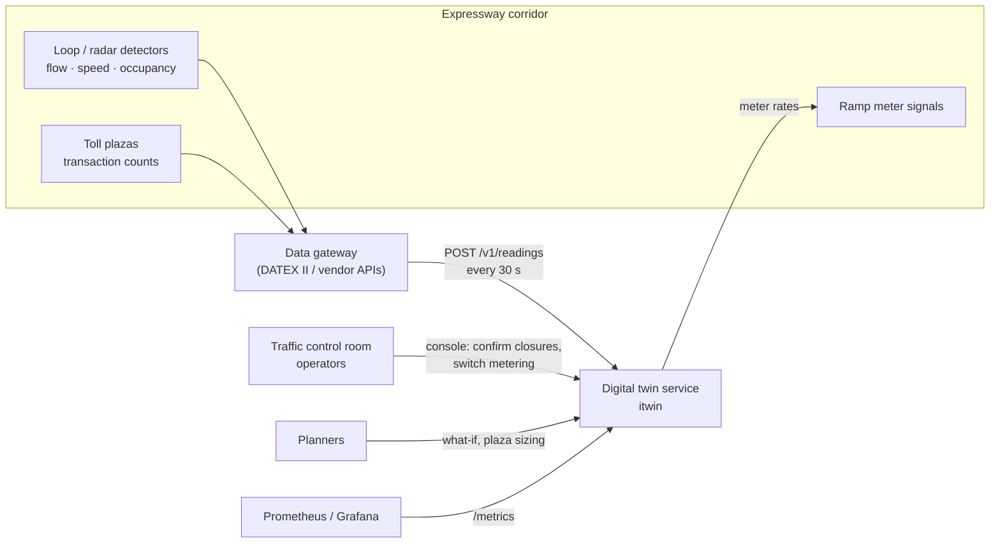
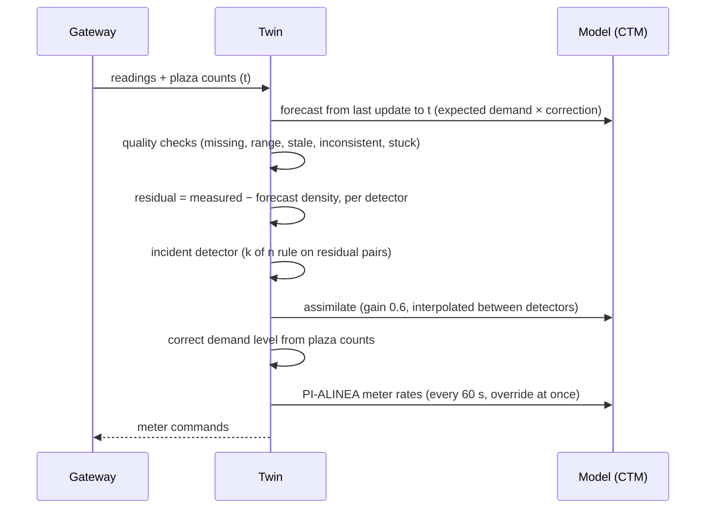

# Architecture

## 1. Context (C4 level 1)

The twin is advisory and narrow on purpose. The only setting it changes on the road is the ramp-meter rate, and that has a queue override. Lane closures enter the model only when an operator confirms them (ADR 0004).

## 2. Containers (C4 level 2)

| Container | Responsibility |
|---|---|
| `network` | Corridor geometry and parameters from TOML, strict validation including the CFL condition |
| `ctm` | Cell Transmission Model: triangular fundamental diagram, capacity drop, FIFO diverge, priority merge, entry queues split ETC / manual, meter limit |
| `sensors` | Reading type, synthetic detectors, rule-based quality checks |
| `estimation` | Constant-gain assimilation with interpolation between detectors; residual-based incident detector |
| `control` | PI-ALINEA ramp metering with queue override |
| `plaza` | Erlang C (M/M/c) lane sizing |
| `scenario` | What-if runs forked from the current state against a baseline |
| `twin` | The loop: forecast → quality → residuals → incidents → assimilate → demand correction → meters |
| `api` | FastAPI, role-based keys, console, metrics |

## 3. The twin loop (every detector interval, 30 s)

## 4. Model

- **Cells:** 0.5 km, 3 lanes (2 on the last kilometre), free-flow speed 80 km/h, 2,000 veh/h/lane, jam density 150 veh/km/lane. Backward wave speed follows from these: 16 km/h. Step 10 s (CFL: 80 km/h × 10 s = 0.22 km < 0.5 km).
- **Capacity drop:** a congested cell discharges at 92 % of capacity. Without it, ramp metering cannot change total delay in a CTM, only move it.
- **Exits:** FIFO. If an exit cannot take its share, the mainline behind it is held too, which is how spillback blocks off-ramps.
- **Entries:** Daganzo's priority merge (ramp share 0.3 when both sides are congested). Each entry has a point queue; at toll plazas the queue is split into ETC and manual lanes with their own service rates.
- **Conservation:** arrived − exited − vehicles on the network is checked in tests under random demand and closures, and printed by the demo. It is zero to floating-point precision.

## 5. Estimation and incident detection

**Assimilation** is a nudging filter, chosen over an ensemble Kalman filter for transparency and cost (ADR 0002). The correction at each detector is measured minus forecast density, multiplied by a gain of 0.6. Cells between detectors get a linear blend, and rejected readings contribute nothing. Measured density comes from flow ÷ speed in free flow and from occupancy in congestion, where speed is unreliable.

**Incident detection** compares readings with what the model expected (ADR 0003), not detectors with each other. The lane drop at km 11 is a known, recurring bottleneck: it is in the model, so it does not raise alarms. A pair of adjacent detectors is suspicious when the upstream one reads at least 7 veh/km/lane denser than forecast and the downstream one at least 1 veh/km/lane lighter. An alarm needs 3 suspicious intervals out of the last 4, and it clears after 6 quiet intervals. When a confirmed closure no longer matches the readings (traffic downstream is higher than the closure allows for 3 minutes), the operator is asked to reopen it.

## 6. Validation on synthetic data

`python examples/validation.py` reproduces these numbers. The "road" is a second copy of the model with 5 % more demand, 3 % random demand variation, 5 % detector noise and hidden incidents. Because the road and the twin share the same model structure, this is a test of the estimation and detection logic, **not** of how well a CTM represents a real expressway (see section 8).

| Check | Result |
|---|---|
| Incident-free peaks 06:00–10:30, 8 seeds | 0 runs with a false alarm |
| 1 lane closed where demand exceeds the remaining 2 lanes by 16–36 % (km 4.0, 7.0, 8.5, 10.0) | detected in 1.5–3.0 min, correct section |
| 1 lane closed where demand ≈ remaining capacity (km 1.0, 2.5) | detected after 20 min / not detected: no queue forms, so there is nothing for flow-based detection to see |
| 1 lane closed just upstream of an on-ramp (km 5.5, demand 1.12 × remaining capacity) | not detected in 20 min: ramp traffic fills the gap at the downstream detector |
| Tracking error, twin vs road, peak, 3 seeds | median 0.0, 95th percentile 4.7, max 6.2 km/h (mean absolute speed error over cells) |
| Ramp metering, full peak, model only | mainline 2,731 → 2,618 veh-h (−4 %), worst travel time 14.8 → 13.0 min; entry queues +112 veh-h; total unchanged |

The detector thresholds were tuned on separate seeds (11–14) from those used in the table (21–37). A sweep showed no false alarms even with the upstream threshold at 4, so the chosen value of 7 has margin. The sample is small, and field data will move these numbers.

**Ramp metering in this corridor protects the mainline but does not reduce total delay.** Queue storage on the ramps (120 vehicles) is short, so the override releases the queue before metering can help much. This matches the literature: benefits depend on storage, capacity drop and off-ramp blocking. The twin's what-if runs show the trade-off for the current situation instead of assuming a benefit.

## 7. Failure modes

| Failure | Behaviour |
|---|---|
| Detector silent or faulty | Reading rejected and listed with its reason; correction comes from the other detectors; alarm pairs that include it make no decision |
| All detectors down | The twin keeps forecasting from expected demand (open loop); sensor health shows `fault` / `no_data` |
| Gateway sends readings out of order | `409`: readings must move forward in time |
| Twin service down | Meters keep their last rate in the field controller; field controllers should fall back to local ALINEA or fixed time (outside this repo) |
| Wrong confirmed closure | Prompt to reopen after 3 minutes of inconsistent readings |

## 8. Limits and the path to a real corridor

- **Calibration.** Fundamental-diagram parameters per segment from detector scatter plots; capacity drop from queue discharge; merge priorities from ramp flows; plaza service rates from transaction logs (separately for ETC and manual, and by vehicle class).
- **Demand.** Origin–destination flows from toll transactions instead of fixed split ratios; profiles by day type, with events and rain.
- **Validation against field data.** Speeds and travel times (for example from probe vehicles or toll-to-toll times) on held-out days, with acceptance targets agreed with the operator (for example GEH < 5 for counts, travel-time error within 10–15 %).
- **Vehicle mix.** Heavy vehicles and motorcycles change capacity and plaza service times; this model uses one vehicle class.
- **Network.** One direction, one corridor. Both directions and connected streets need a network CTM (Link Transmission Model or similar) or a mesoscopic simulator.
- **Incident detection.** Flow-based detection misses closures that do not create queues and some closures next to on-ramps. Video analytics and probe data should complement it.
